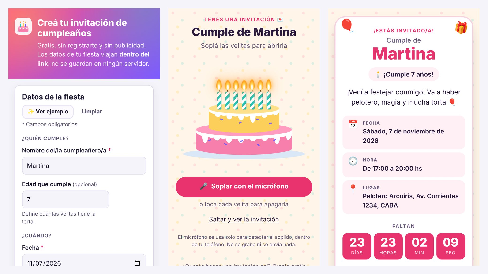

# 🎂 Invitación de cumpleaños

Generador de invitaciones de cumpleaños **estático, gratis y sin backend**. Completás un formulario, obtenés un link (y un QR) y lo mandás por WhatsApp. Quien lo abre ve una torta con velitas encendidas y, para abrir la invitación, **tiene que soplarlas de verdad** (o tocarlas, si no quiere usar el micrófono). Después ve los datos de la fiesta, una cuenta regresiva y puede confirmar asistencia por WhatsApp, agregar el evento al calendario y abrir el mapa.

- **Sin base de datos, sin build, sin dependencias, sin API keys.** Es HTML + CSS + JS puro.
- **Sin cookies, sin analytics y sin requests a terceros.** Funciona offline.
- **Privacidad por diseño:** los datos de la fiesta viajan dentro del link, después del `#`. Esa parte nunca se manda al servidor, así que no queda en ningún log.
- Funciona igual en **GitHub Pages**, en un **VPS con nginx** o abriendo `index.html` directo desde la compu.
- Licencia **MIT**. Forkealo y usalo como quieras.



**Demo:** <https://invitacion.blucaro.site>

---

## Índice

- [Cómo se usa](#cómo-se-usa)
- [Cómo funciona](#cómo-funciona)
- [Deploy en GitHub Pages](#1-github-pages)
- [Deploy en un VPS con nginx](#2-vps-con-nginx-invitacionblucarosite)
- [La vista previa en WhatsApp](#la-vista-previa-en-whatsapp)
- [Personalización](#personalización)
- [Apéndice: backend opcional (confirmaciones y links cortos)](#apéndice-backend-opcional-confirmaciones-y-links-cortos)
- [Licencia](#licencia)

---

## Cómo se usa

1. Abrí el sitio (sin nada después del `#`): aparece el **generador**.
2. Completá los datos. Solo el nombre, la fecha y la hora son obligatorios:
   - nombre de quien cumple y edad (la edad define cuántas velitas tiene la torta; desde los 11 años se usan velas con números),
   - una foto, si querés (ver [la foto](#la-foto)),
   - fecha, hora y, si querés, hora de fin,
   - lugar y link de Google Maps,
   - mensaje para los invitados (o tocá **✨ Sugerir mensaje** para que te proponga uno; ver [sugerencias con IA](#sugerencias-de-mensaje-con-ia)),
   - tu WhatsApp, que es donde te van a llegar las confirmaciones,
   - el tema (**Infantil**, **Elegante** o **Minimalista**) y, si querés, un color propio.
3. A la derecha (o abajo, en el celular) se actualiza la **vista previa en vivo**. Con **✨ Ver ejemplo** se carga una fiesta de muestra.
4. Copiá el link, **compartilo por WhatsApp** o **descargá el QR** en PNG para imprimirlo.
5. Guardate el **link para editar más tarde**: abre el formulario con tus datos cargados (no lo compartas).

Del lado del invitado:

- **Soplido real:** toca «Soplar con el micrófono», el navegador pide permiso y se analiza el volumen con la Web Audio API (un `AnalyserNode`). Hace falta un soplido fuerte y sostenido de unos 0,5 s, con mucha energía en graves, para que la voz normal no lo dispare. Cuando lo detecta, las velas se apagan una por una, sale confeti y se abre la invitación. El micrófono se libera enseguida y no se graba ni se manda nada.
- **Sin micrófono:** si no da permiso, si el navegador no lo soporta o si el sitio no está en HTTPS, se apagan **tocando cada velita**. También hay un link **«Saltar y ver la invitación»** y todo se puede hacer con teclado.
- Ya abierta, la invitación muestra los datos, una **cuenta regresiva en vivo**, el botón **Confirmo asistencia** (abre WhatsApp a tu número con un mensaje editable, por ejemplo «¡Confirmo! Vamos 2 🎉»), **Agregar al calendario** (descarga un `.ics` generado en el teléfono), **Cómo llegar** y **Más confeti**.

## Cómo funciona

Una sola página (`index.html`) decide qué mostrar según el hash de la URL:

| URL | Qué muestra |
|---|---|
| `https://sitio/` | El generador |
| `https://sitio/#i=Mh9NYXJ0…` | La invitación |
| `https://sitio/#e=Mh9NYXJ0…` | El generador con esos datos cargados, para editar |
| `https://sitio/#i=Mh9NYXJ0…&f=wUklG…` | La invitación con foto |
| `https://sitio/?s=k3f9a2` | La invitación, con los datos guardados en tu servidor ([link corto](#links-cortos), opcional) |

Los datos se serializan así: **campos en un orden fijo, separados por el carácter `\x1f` → UTF-8 → base64url**. No hay claves ni comillas, la fecha va como `AAAAMMDD`, las horas como `HHMM` y los campos vacíos del final se omiten. Por ejemplo:

```
2␟Martina␟20261107␟1700␟180␟7␟2000␟5491123456789␟Pelotero Arcoíris, Av. Corrientes 1234␟¡Vení a festejar!
```

| # | Dato | # | Dato |
|---|---|---|---|
| 0 | versión del formato (`2`) | 7 | WhatsApp (solo dígitos) |
| 1 | nombre | 8 | lugar |
| 2 | fecha `AAAAMMDD` | 9 | mensaje |
| 3 | hora `HHMM` | 10 | link de mapa (solo `http/https`) |
| 4 | offset horario de quien creó la invitación (minutos) | 11 | tema: vacío infantil, `e` elegante, `m` minimalista |
| 5 | edad | 12 | color propio `rrggbb` |
| 6 | hora de fin `HHMM` (opcional) | 13 | endpoint de RSVP propio (opcional) |

Así el link queda alrededor de un 30 % más corto que con JSON. Los links viejos (versión 1, un JSON con claves cortas como `{"v":1,"n":"Martina",…}`) se siguen abriendo igual.

### La foto

La foto también viaja dentro del link, en un parámetro aparte (`&f=`), así que sigue sin haber servidor ni terceros:

- El navegador de quien crea la invitación la recorta en cuadrado (en las fotos verticales, un poco más arriba del centro, para no cortar caras), la achica (hasta 176 px) y la comprime en WebP o JPEG hasta que pese **menos de 3,6 KB**. Nunca se sube a ningún lado.
- `f` = `w` + base64url(WebP) o `j` + base64url(JPEG). Al abrir la invitación se verifican los bytes del formato y se muestra con ``. Si la foto está rota, la invitación se abre igual, sin foto.
- Con foto, el link pasa de ~250 a ~5.000 caracteres. WhatsApp y los navegadores lo manejan sin problema, pero **un QR no tiene capacidad para una foto**: el QR abre la misma invitación sin la foto (el generador lo avisa). Si usás [links cortos](#links-cortos), el link queda en ~40 caracteres y el QR sí incluye la foto.

### Sugerencias de mensaje con IA

El botón **«✨ Sugerir mensaje»** (con tono automático, divertido, emotivo o formal) propone un texto en español rioplatense según la edad, el tema y el tono:

- **Si el navegador trae IA incorporada** (por ejemplo, Chrome con Gemini Nano, mediante las APIs `LanguageModel` o `Writer`) y el modelo **ya está descargado**, el mensaje lo escribe esa IA. Corre **dentro del dispositivo**: sin API keys, sin costo y sin mandar nada afuera. Nunca se dispara la descarga del modelo (son varios GB).
- **Si no** (hoy, la mayoría de los celulares), usa un generador propio que combina frases pensadas para chicos, adolescentes y adultos, con frases especiales para 1, 15, 18 y los cumpleaños redondos (30, 40, 50…). Funciona offline e igual en todos lados.

Cada clic da otra idea, y **Deshacer** vuelve a lo que habías escrito. El código está en `assets/suggest.js`; para sumar frases, agregalas a las listas de `T` y `MILESTONES`.

Gracias al offset horario (campo 4), la cuenta regresiva y el `.ics` son correctos aunque el invitado esté en otro huso horario: la hora se muestra tal como la escribiste y, si el invitado está en otra zona, se le aclara su hora local.

Al cargar, todo lo que viene en el link se valida: los textos se insertan con `textContent` (nunca como HTML), los links de mapa solo pueden ser `http/https` y una CSP bloquea cualquier script o conexión externa. Si el hash está roto o incompleto, aparece un aviso amable y el generador.

### Archivos

```
index.html          la página: generador + invitación
assets/styles.css   estilos, temas (variables CSS) y modo claro/oscuro
assets/app.js       lógica: codificación, generador, invitación, soplido, .ics
assets/qr.js        generador de QR propio (MIT, sin dependencias)
assets/confetti.js  confeti en <canvas> (MIT, sin dependencias)
assets/suggest.js   sugerencias de mensaje (IA del navegador o plantillas)
assets/og.jpg       imagen para la vista previa al compartir
assets/favicon.svg, assets/icon-192.png
extras/rsvp-server/ backend OPCIONAL (ver apéndice)
```

### Probarlo en tu compu

Abrí `index.html` con doble clic: el generador funciona y genera links válidos. Esos links apuntan a `file:///…`, así que solo abren en tu compu. Para compartirlos, publicá el sitio.

Para probar el micrófono hace falta `https` o `localhost`:

```bash
python3 -m http.server 8000
# abrí http://localhost:8000
```

## Deploy

### 1) GitHub Pages

1. Hacé un fork (o subí estos archivos a un repo tuyo) y hacé push a `main`.
2. En el repo, andá a **Settings → Pages**.
3. En **Build and deployment**, elegí **Source: Deploy from a branch**, **Branch: `main`** y la carpeta **`/ (root)`**. Guardá.
4. En uno o dos minutos queda publicado en `https://TU-USUARIO.github.io/NOMBRE-DEL-REPO/`.
5. Cambiá el dominio de `og:image` y `twitter:image` en `index.html` por el tuyo (ver [la vista previa en WhatsApp](#la-vista-previa-en-whatsapp)).

GitHub Pages ya sirve todo con HTTPS, así que el micrófono funciona. El archivo `.nojekyll` evita que GitHub procese el sitio con Jekyll.

### 2) VPS con nginx (invitacion.blucaro.site)

```bash
# en el servidor
sudo mkdir -p /var/www/invitacion
sudo git clone https://github.com/Fracunzera/cumpleinvitacion.git /var/www/invitacion
# para actualizar más adelante:
cd /var/www/invitacion && sudo git pull
```

Creá `/etc/nginx/sites-available/invitacion`:

```nginx
server {
    listen 80;
    server_name invitacion.blucaro.site;
    root /var/www/invitacion;
    index index.html;

    location / {
        try_files $uri $uri/ /index.html;
    }

    # Opcional pero recomendable
    location /assets/ {
        expires 7d;
        add_header Cache-Control "public";
    }
    location ~ /\.(git|nojekyll) { deny all; }
    location /extras/ { deny all; }

    add_header X-Content-Type-Options nosniff always;
    add_header Referrer-Policy no-referrer always;
    add_header Permissions-Policy "microphone=(self), camera=(), geolocation=()" always;

    gzip on;
    gzip_types text/css application/javascript image/svg+xml;
}
```

Activalo y recargá nginx:

```bash
sudo ln -s /etc/nginx/sites-available/invitacion /etc/nginx/sites-enabled/
sudo nginx -t && sudo systemctl reload nginx
```

Agregá **HTTPS** con certbot. Es casi obligatorio: sin HTTPS el navegador no deja usar el micrófono y solo funciona apagar las velas tocándolas.

```bash
sudo certbot --nginx -d invitacion.blucaro.site
```

Asegurate de que el DNS de `invitacion.blucaro.site` (registro A/AAAA) apunte a la IP del VPS antes de correr certbot.

## La vista previa en WhatsApp

Cuando pegás un link en WhatsApp, su servidor descarga la página y lee las etiquetas Open Graph. Como los datos de cada fiesta van en el `#`, **el servidor nunca los ve** y no puede armar una vista previa personalizada. Por eso `index.html` trae una tarjeta **genérica**: «¡Estás invitado/a! 🎂», una descripción y `assets/og.jpg` (1200×630, menos de 300 KB, que es el límite de WhatsApp para la imagen grande).

Hay dos cosas a tener en cuenta:

- `og:image` **tiene que ser una URL absoluta**. Viene configurada para `https://invitacion.blucaro.site/assets/og.jpg`. Si hacés un fork, cambiala por tu dominio (por ejemplo `https://tu-usuario.github.io/cumpleinvitacion/assets/og.jpg`) en `og:image` y `twitter:image`.
- WhatsApp guarda la vista previa en caché por un tiempo. Si la cambiás, puede tardar en actualizarse.

### Alternativa: vista previa personalizada con `?i=` (trade-off de privacidad)

La página también acepta los datos en la query string: `https://sitio/?i=Mh9NYXJ0…` (es el mismo valor que va después de `#i=`). Con eso, un servidor **puede** leer los datos y poner el nombre en la tarjeta, por ejemplo «🎂 ¡Estás invitado/a al cumple de Martina!».

- ✅ La vista previa en WhatsApp muestra el nombre y la fecha.
- ❌ Los datos de la fiesta (nombre, dirección, teléfono) **llegan al servidor y quedan en los logs** de nginx, del proxy, etc. Se pierde la privacidad por diseño.
- ❌ Necesita algo del lado del servidor (en un sitio estático puro como GitHub Pages no hay forma de cambiar las etiquetas). El backend opcional de abajo ya lo hace.

Para usarlo, generá el link normal y reemplazá `#i=` por `?i=`. Si lo activás, considerá no guardar la query en los logs de nginx (ver la configuración del apéndice).

Los [links cortos](#links-cortos) (`?s=`) también traen la vista previa personalizada, sin poner los datos en la URL.

## Personalización

- **Temas:** están en `assets/styles.css`, bajo `[data-theme="kids"]`, `[data-theme="elegant"]` y `[data-theme="minimal"]`. Cada uno define variables CSS (`--bg`, `--accent`, `--font-display`, colores de la torta, `--confetti`…) con su versión oscura dentro de `@media (prefers-color-scheme: dark)`. Para sumar un tema nuevo, copiá un bloque, agregá la letra en `THEMES` dentro de `assets/app.js` y una opción en el formulario de `index.html`.
- **Tipografías:** se usan fuentes del sistema para no pedir nada a terceros. Si querés una fuente propia, ponela en `assets/` y declarala con `@font-face`. La CSP ya permite fuentes de tu propio dominio.
- **URL pública fija:** si querés que el generador arme siempre los links con un dominio determinado (por ejemplo, cuando lo usás desde `file://`), poné ese dominio en `data-public-url` del `<html>`: `<html lang="es-AR" data-public-url="https://invitacion.blucaro.site/">`.

## Accesibilidad

- Se puede usar sin dar permisos: las velas son botones (se apagan con clic, toque, Enter o Espacio) y hay un link para saltar el juego.
- El foco es visible, los mensajes de estado usan `aria-live`, el formulario tiene etiquetas y errores asociados, y las imágenes decorativas están ocultas para lectores de pantalla.
- Se respeta `prefers-reduced-motion` (menos confeti y sin animaciones bruscas) y el modo claro/oscuro del sistema.

---

## Apéndice: backend opcional (confirmaciones y links cortos)

> **Totalmente opcional.** El sitio funciona 100% sin esto: las confirmaciones llegan por WhatsApp y los links llevan todos los datos adentro. Esto es para quien tenga un VPS (o un server en casa) y quiera además **una lista de confirmados** en un solo lugar y/o **links cortos**.

`extras/rsvp-server/server.py` es un servidor chiquito en Python 3 (solo biblioteca estándar, sin `pip install`) con SQLite:

- `GET /api/rsvp/challenge`: entrega un desafío anti-spam firmado (ver abajo).
- `POST /api/rsvp`: guarda una confirmación `{event, name, count, going, note, pow}`. Valida los datos y el desafío, limita el tamaño y aplica un rate limit por IP.
- `GET /api/rsvp?token=…`: lista los eventos. Con `&event=<id>` muestra la tabla de confirmados de esa fiesta. Agregando `&format=json` devuelve JSON.
- `GET /?i=…`: sirve `index.html` con `og:title`/`og:description` personalizados (el modo con vista previa personalizada de arriba).
- `POST /api/s`, `GET /api/s/<código>` y `GET /?s=<código>`: [links cortos](#links-cortos).

### "No soy un robot" (anti-spam propio)

El formulario de confirmación del backend tiene una casilla **«No soy un robot»** que no usa Google ni ningún servicio externo, y no necesita API keys. Funciona con una **prueba de trabajo**, como Hashcash o ALTCHA:

1. Al tildar la casilla, el navegador pide un desafío a `GET /api/rsvp/challenge`. El server responde con un valor aleatorio y su vencimiento (10 minutos), firmados con HMAC.
2. El navegador busca un número que, sumado al desafío, dé un SHA-256 que empiece con N bits en cero (por defecto 17: ~0,2 s en una compu y ~1 s en un celular). Para una persona es un clic, pero mandar confirmaciones en masa le cuesta cómputo a un bot.
3. Al enviar, el server verifica la firma, el vencimiento y el hash, y que el desafío **no se haya usado antes**.

Además hay un **campo trampa** invisible (si viene completo, se rechaza) y un **límite de envíos por IP**. No es imposible de saltar (ningún captcha lo es), pero frena el spam automático sin depender de terceros. La dificultad se ajusta con `RSVP_POW_BITS`: cada bit extra duplica el tiempo de cálculo.

### Instalación

```bash
# usuario sin privilegios y carpeta para la base
sudo useradd --system --no-create-home invitacion
sudo mkdir -p /var/lib/invitacion && sudo chown invitacion /var/lib/invitacion
```

`/etc/systemd/system/invitacion-rsvp.service`:

```ini
[Unit]
Description=Invitacion de cumpleanos - RSVP opcional
After=network.target

[Service]
User=invitacion
Environment=RSVP_TOKEN=cambia-esto-por-algo-largo-y-secreto
Environment=RSVP_DB=/var/lib/invitacion/rsvp.sqlite3
Environment=SITE_ROOT=/var/www/invitacion
Environment=PORT=8787
# Opcional: dificultad del anti-spam (17 ≈ 1 s en un celular) y clave fija para
# firmar desafíos (si no se pone, se genera una al iniciar).
# Environment=RSVP_POW_BITS=17
# Environment=RSVP_SECRET=otra-clave-larga
# Días después de la fiesta en que se borra cada link corto (default: 60)
# Environment=SHORT_DAYS=60
ExecStart=/usr/bin/python3 /var/www/invitacion/extras/rsvp-server/server.py
Restart=on-failure
NoNewPrivileges=true
ProtectSystem=strict
ReadWritePaths=/var/lib/invitacion

[Install]
WantedBy=multi-user.target
```

```bash
sudo systemctl daemon-reload && sudo systemctl enable --now invitacion-rsvp
```

Agregá esto dentro del `server { … }` de nginx:

```nginx
    location /api/ {         # /api/rsvp (confirmaciones) y /api/s (links cortos)
        proxy_pass http://127.0.0.1:8787;
        proxy_set_header X-Real-IP $remote_addr;
        client_max_body_size 20k;   # un link corto con foto pesa ~5 KB
    }

    # Vista previa personalizada en WhatsApp para ?i= y ?s= (opcional: sin
    # esto los links cortos funcionan igual, con la vista previa genérica).
    location = / {
        access_log off;   # no guardar los datos de la fiesta en los logs
        if ($args ~ "(^|&)[is]=") {
            proxy_pass http://127.0.0.1:8787;
        }
        try_files /index.html =404;
    }
```

### Uso

1. En el generador, abrí **Opciones avanzadas** y poné `/api/rsvp` en «Endpoint propio de confirmaciones». Por seguridad, la invitación solo envía datos a un endpoint **del mismo dominio**.
2. La invitación va a mostrar, además del botón de WhatsApp, un mini formulario «O dejá tu confirmación acá».
3. El generador te muestra la URL para ver la lista: `https://invitacion.blucaro.site/api/rsvp?event=<id>&token=TU_RSVP_TOKEN`.

Para respaldar los datos, copiá el archivo `rsvp.sqlite3`. Para empezar de cero, borralo.

### Links cortos

Con el backend andando y `location /api/` en nginx, el generador lo detecta solo (pide `GET /api/s`) y muestra el botón **✂️ Acortar link** debajo del link. Al tocarlo:

1. El navegador manda a `POST /api/s` lo mismo que iría en el link: `{"i": "<datos>", "f": "<foto>"}`. El server valida que sea una invitación bien formada, que la foto sea WebP/JPEG en base64url y el tamaño, y aplica un límite de 30 links cada 10 minutos por IP.
2. Lo guarda en SQLite (tabla `short`, en el mismo archivo que las confirmaciones) y devuelve un código de 6 caracteres sin letras confusas (`0/o`, `1/i/l`). Si ya existía uno con los mismos datos, devuelve ese mismo código.
3. El link, el botón de WhatsApp, «Abrir invitación» y el QR pasan a usar `https://invitacion.blucaro.site/?s=k3f9a2`. Como entra de sobra en un QR, **el QR también lleva la foto**.

Si después cambiás algo del formulario, el link vuelve a ser el largo y hay que acortarlo de nuevo (los links cortos que ya mandaste siguen mostrando la versión vieja). El link para editar sigue siendo el largo: no se guarda en el servidor.

Del lado del invitado, la página ve `?s=`, pide los datos a `GET /api/s/<código>` y sigue igual que con un link largo. Si el código no existe o venció, muestra el aviso de link roto.

**Privacidad:** a diferencia de los links largos, acá los datos de la fiesta (nombre, dirección, teléfono, foto) **quedan guardados en tu servidor**. Para que no se acumulen, cada link corto **se borra solo 60 días después de la fecha de la fiesta** (se ajusta con `SHORT_DAYS`). Para que nadie pueda recorrer códigos al azar, cada IP puede pedir como mucho 30 códigos inexistentes cada 10 minutos.

#### Correr el backend en un server de casa (por VPN)

El backend no tiene que estar en el VPS: puede correr en una compu de tu casa conectada al VPS por una VPN (WireGuard, Tailscale, etc.). nginx sigue en el VPS y solo cambia a dónde reenvía:

1. En el server de casa, cloná el repo y usá el mismo servicio de systemd, pero escuchando en la IP de la VPN, y con `SITE_ROOT` apuntando a la carpeta del repo (la necesita para la vista previa personalizada):

   ```ini
   # HOST = la IP de la VPN del server de casa
   Environment=HOST=10.8.0.2
   Environment=PORT=8787
   Environment=SITE_ROOT=/ruta/al/repo/cumpleinvitacion
   ```

2. En nginx (en el VPS), cambiá `http://127.0.0.1:8787` por `http://10.8.0.2:8787` en los dos `proxy_pass`. El `X-Real-IP` sigue llegando bien, así que los límites por IP funcionan igual.
3. Asegurate de que el puerto 8787 solo sea accesible desde la VPN (por ejemplo, con el firewall del server de casa), no desde internet.

Si el server de casa se apaga, los links largos siguen funcionando; los cortos no abren hasta que vuelva.

---

## Licencia

[MIT](LICENSE). El generador de QR (`assets/qr.js`) es una implementación propia que sigue el algoritmo de la norma ISO/IEC 18004 y la estructura de la [QR Code generator library](https://www.nayuki.io/page/qr-code-generator-library) de Project Nayuki (MIT).
